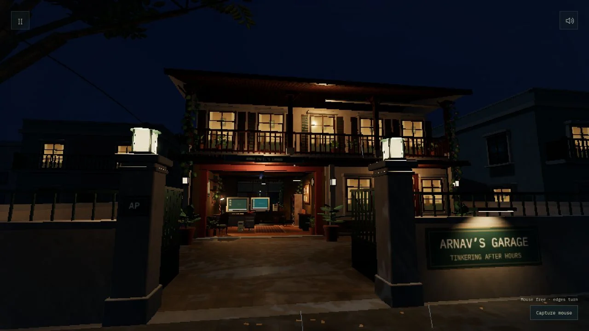

# Arnav's garage

My portfolio as a walkable garage on an imagined Koramangala street. Enter, look around, and use the two old computers to explore my work and projects. Built with Astro, React, TypeScript and Three.js.



## Run locally

Use Node 24 LTS (`.nvmrc`) and npm. The minimum supported Node version is 22.23.4.

```sh
npm ci
npm run dev
```

Open [localhost:4173](http://127.0.0.1:4173/). No backend, API keys or external services are needed. `/camera-workshop/` redirects to the homepage for older shared links.

WASD moves, the mouse looks around, Shift toggles running, Space jumps and E interacts. Escape pauses or steps away from a computer. Touch devices use guided destination controls. Desktop entry captures the mouse after a click; exploration stays paused until capture succeeds. Escape releases the pointer into the menu, and returning to play captures it again. Sound begins after entry, with mute and volume controls. Projects and résumé pages also work without 3D graphics or JavaScript.

Pause with Escape, then open **Graphics & display** to tune the scene live. Resolution, smoothing, lighting, shadows, glow, fog and colour settings stay in your browser. **Compare current look** temporarily shows the defaults; **Reset current look** restores them. **Copy settings** exports your experiment for choosing future defaults. Rendering never automatically downgrades.

## Develop and verify

| Command           | Purpose                                                            |
| ----------------- | ------------------------------------------------------------------ |
| `npm run dev`     | Local Astro development server                                     |
| `npm run format`  | Format source, tests, configuration and docs                       |
| `npm run check`   | Astro and TypeScript diagnostics                                   |
| `npm test`        | All current contract tests, including safe isolated content checks |
| `npm run build`   | Type-check and generate the static `dist/` site                    |
| `npm run preview` | Serve `dist/` locally on port 4173                                 |
| `npm run verify`  | Formatting check, contract tests and production build              |

After a production build, run the Chromium smoke tests:

```sh
npx playwright install chromium
npm run test:browser
```

The browser suite starts its own preview on port 4179. CI installs dependencies from the lockfile, runs verification and checks entry, menu/PC interaction, asset loading, redirects and mobile reading. Browser traces and reports are local generated files. CI does not deploy or publish the site.

## Structure and content

- `src/components/`: garage shell, recovery UI and computer desktops.
- `src/lib/garage/`: controls, navigation, rendering, city, geometry and sound.
- `src/lib/graphics/`: shared texture helpers.
- `src/content/`: Markdown projects and articles, validated by `src/content.config.ts`.
- `src/pages/`: homepage and independent work, writing and résumé pages.
- `public/assets/`: optimized runtime assets and their font licenses.
- `tests/`: behavior contracts and browser smoke tests.

See the [architecture guide](docs/architecture.md), [content editing guide](docs/editing-content.md) and [asset sources](docs/assets.md). Add projects and articles through Markdown; no new room or computer is required. Drafts stay out of the built website, but are still source files in the repository.

Earlier designs, original photos, research notes and working artwork are archived outside this repository. The repository contains the current garage and its reading pages. The garage is fictional; Kazam content is a public work account, without its internal application, logs or source data.

The generated site assumes hosting at a domain root. Hosting under a repository subpath needs a base-path adjustment before deployment. Third-party asset licenses are documented separately; an open-source license for the project's own code has not been selected.
